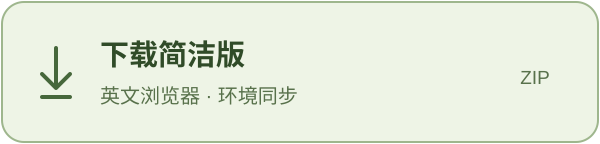

<p align="center">
  
</p>

<p align="center">Windows 10 / 11 · 64 位 · 中文界面 · MIT 开源</p>

<p align="center">
  <a href="https://github.com/chunson-studio/chunson-space/releases/latest/download/Chunson-Full-Windows-x64.zip"></a>
  &nbsp;
  <a href="https://github.com/chunson-studio/chunson-space/releases/latest/download/Chunson-Simple-Windows-x64.zip"></a>
</p>

<p align="center">
  <a href="https://github.com/chunson-studio/chunson-space/releases/latest">全部下载与更新说明</a> ·
  <a href="#版本怎么选">版本怎么选</a> ·
  <a href="#快速开始">快速开始</a> ·
  <a href="#从源码构建">源码构建</a>
</p>

## 版本怎么选

**需要管理多个账号、比较模型输出，选完整版。只想打开英文登录浏览器、同步地区与时区，选简洁版。**

| | 完整版 | 简洁版 |
| :--- | :--- | :--- |
| 主要用途 | 账号管理、独立 IP、模型测试 | 英文登录浏览器、环境同步 |
| 账号管理 | 保存账号档案，支持导入本机 Codex 已有授权 | 不管理账号库，在浏览器里直接登录 |
| 网络方式 | 跟随 FlClash，或为账号配置独立 IP 与端口 | 跟随 FlClash 当前网络 |
| 英文浏览器 | 不同账号分别保存浏览器资料 | 使用一套独立的浏览器资料 |
| 地区与时区 | 检测出口，手动同步 Windows 地区与时区 | 同样支持 |
| 模型测试 | Ciallo、鹈鹕绘图、换题绘图、检查与改进 | 不包含 |
| Codex 分身 | 管理一个受管分身，保留本体独立 | 不包含 |
| 北京时间小组件 | 内置 | 内置 |
| **下载** | **[下载完整版 ZIP](https://github.com/chunson-studio/chunson-space/releases/latest/download/Chunson-Full-Windows-x64.zip)** | **[下载简洁版 ZIP](https://github.com/chunson-studio/chunson-space/releases/latest/download/Chunson-Simple-Windows-x64.zip)** |

## 完整版 · 账号与测试工作台

把账号资料、浏览器和测试结果放在一起管理。

- **账号档案**：保存授权与配置；首页“导入本机账号”可读取本机 Codex 已保存的 ChatGPT 授权，无需重新登录。
- **独立网络**：筛选和管理订阅 IP，在“跟随本机”和“独立 IP”之间切换，也可更换已分配的 IP。
- **账号浏览器**：分别保存浏览器资料；独立模式使用对应出口与时区，跟随模式沿用本机环境。
- **模型测试**：Ciallo 回复对比、鹈鹕静态 SVG / HTML 动画、换题绘图，以及“生成 → 检查 → 修改”。
- **结果与缓存**：查看历史回复、作品、耗时和返回的缓存 token 数据。测试可收起到后台，账号之间并行，同一账号内依次执行。
- **受管分身**：管理一个 Codex 分身，在其中切换账号；本机 Codex 保持独立，分身不继承本体 Skills、MCP 或工具配置。

导入本机账号只复制已有授权，不修改本体的授权或运行状态，也不会自动开始测试。重复导入同一账号时更新授权，保留已有网络配置。

## 简洁版 · 英文登录浏览器

保留日常登录需要的几个动作，打开就能看懂。

1. **检查网络**：识别 FlClash 当前入口，检测出口 IP、国家/地区和时区。
2. **同步环境**：点击“同步地区与时区”，让 Windows 对应当前出口。
3. **打开浏览器**：使用本机 Chrome 或 Edge，单独保存英文浏览器资料。
4. **进入网站**：同时打开 [ChatGPT](https://chatgpt.com/) 和 [IPPure Claude 页面](https://ippure.com/claude)。

只有 Edge 也可以使用，无需专门安装 Chrome。这里使用的是本机浏览器的独立资料目录。

## 两版共有 · 北京时间小组件

任务栏上的时间卡片，固定显示 **北京时间 UTC+8**。

- 随软件启动；两版同时打开，也只保留一个小组件。
- 主软件关闭后，时钟继续显示；右键可退出。
- 点击软件里的“北京时间”按钮，可以重新打开。
- **只显示时间，不改变 Windows 系统时区。**

## 快速开始

### 1. 下载并完整解压

选择上方任一版本，解压整个 ZIP 文件，再打开对应程序：

| 版本 | 启动文件 |
| :--- | :--- |
| 完整版 | `ChunsonSwitch.exe` |
| 简洁版 | `ChunsonLogin.exe` |

不要直接在压缩包里运行，也不要只取出一个 EXE。发布包已包含 .NET 运行时，普通使用无需安装开发工具。

### 2. 准备浏览器与网络

- 系统：**Windows 10 / 11 x64**。
- 浏览器：本机已安装 **Chrome 或 Edge**。
- 网络：**必须使用 FlClash，两版均只适配这个客户端。** 启动时会检查；没有安装时，点击“下载并安装 FlClash”即可下载、校验并打开官方安装向导。已有安装会直接复用，也可选择已有便携版。
- 安装后在 FlClash 中添加自己的订阅、选择节点，再返回“检查并继续”。安装程序不附送订阅。支持只开 TUN，但仍需开启主 HTTP / mixed 入口，供工具和独立浏览器连接。

下载失败时可从 [FlClash 官方发布页](https://github.com/chen08209/FlClash/releases)手动安装，再回到准备页检查。工具不会把其他代理软件当作 FlClash，也不会替你修改节点或系统代理设置。

### 3. 检查后按需同步

先查看出口和环境状态。需要修改时，主动点击“同步地区与时区”；之后再打开浏览器，或在完整版中导入、添加账号。

同步保留 Windows 显示语言、地区格式和输入法；退出软件不会恢复旧时区。FlClash 的分流规则仍会影响各网站的实际出口。

## 可选：重新登录后做对比测试

如果准备重新整理自己的登录状态，可以按下面的顺序操作：

1. 在 FlClash 中选好稳定的出口；完整版可参考 IP 筛选评分。
2. 对使用邮箱与密码登录的账号，在官方登录页面点击 **“忘记密码”**，通过邮件重置密码，再用新密码登录。使用 Google、Apple 或 Microsoft 等方式登录的账号，按原登录方式及其账户恢复流程处理。
3. 检查双重验证（2FA）。没有设置的可以启用；已有设置需要更新时，先确认能够完成验证并保管好恢复方式。
4. 在账号安全设置中选择 **退出所有设备**，待退出生效后继续。
5. 回到本项目重新登录并完成 Codex 授权。仅登录 ChatGPT 网页还不代表项目已保存授权；以项目提示保存成功为准。此时应重新授权，不导入重置前留下的旧凭证。
6. 如采用作者的观察方法，登录后静置 **24 小时**，期间不使用该账号；第二天在完整版中手动运行模型测试，比较回复、作品、耗时与缓存数据。

这是一套可选的账号整理与对比方法，不是使用软件的前置条件。高 IP 评分、重置密码、更换 2FA 或静置 24 小时，均不能保证解除登录限制或提升模型能力；24 小时是作者建议的观察间隔，不是官方恢复规则。项目不会自动更改密码、2FA 或退出你的设备。

## 常见问题

<details>
<summary><strong>数据保存在哪里？</strong></summary>

账号授权、浏览器资料、订阅和个人配置保存在本机用户目录，不包含在本仓库和公开发布包中。时钟位置保存在 `%LOCALAPPDATA%/ChunsonWidgets`。请不要将自己的运行资料提交到公开仓库。

</details>

<details>
<summary><strong>缓存 token 能代表“智力”吗？</strong></summary>

不能。测试用于观察回复、绘图和修改能力的差异，不提供整体智力结论。缓存 token 是服务返回的使用数据，不作为能力分数；缺少数据与数值为 0 会分开显示。

</details>

<details>
<summary><strong>同步环境后，网站一定能登录成功吗？</strong></summary>

环境同步、网络连通和网站登录是不同的环节。本工具不保证网站登录成功，也不据此判断账号是否受到风控。

</details>

## 从源码构建

需要 **Windows x64、.NET 10 SDK、Windows PowerShell**。在仓库根目录执行：

```powershell
./build.ps1 -Edition All -Verify -Package -Output ./out/release
```

使用 `-Edition Full` 或 `-Edition Simple` 可单独构建；`-DotnetPath` 可指定 SDK。

```text
chunson-space/
├─ full/             完整版：账号、网络、测试与分身
├─ simple/           简洁版：网络检测与英文浏览器
├─ taskbar-clock/    两版共用的北京时间小组件
├─ FlClashSetup/     两版共用的 FlClash 检查与安装引导
└─ build.ps1         构建、离线验证与打包入口
```

首次构建从 NuGet 还原固定版本依赖；完整版从 Mihomo 官方发布地址下载固定版本并校验 SHA-256。构建不会启动账号登录、修改代理或同步系统设置；离线界面验证窗口不占据桌面、不抢焦点。离线验证不等于真实登录、模型请求或系统设置修改已通过验收。

## 许可

原创部分采用 **[MIT License](LICENSE)**，允许使用、修改、分发及商用，须保留版权声明和许可文本。

第三方组件遵循各自许可证。Mihomo 作为独立外部进程使用，适用 GPL-3.0，详情见 [Mihomo 声明](full/windows/ThirdParty/Mihomo)。YamlDotNet、GeoTimeZone、ModelTrace 及字体的声明保留在对应 `ThirdParty` 目录；本项目的 MIT 许可不替代它们的许可证。

---

<p align="center">
  <strong>Chunson Space · 椿生</strong><br>
  <a href="https://github.com/chunson-studio/chunson-space/releases/latest">下载软件</a> ·
  <a href="https://github.com/chunson-studio/chunson-space/issues">反馈问题</a>
</p>
