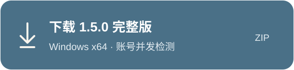
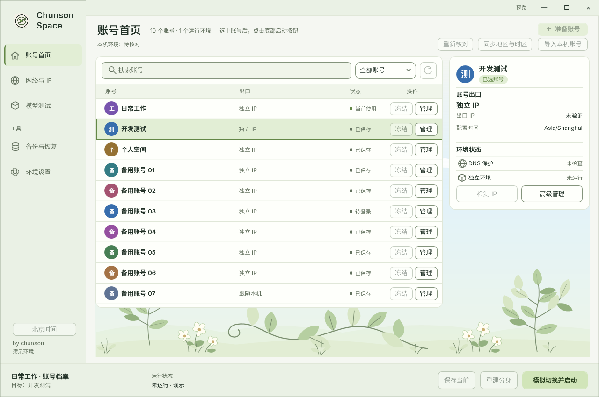
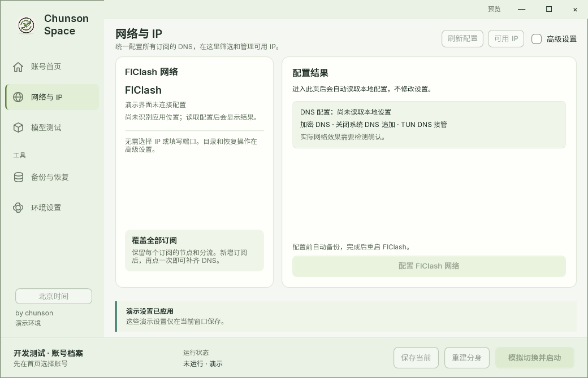
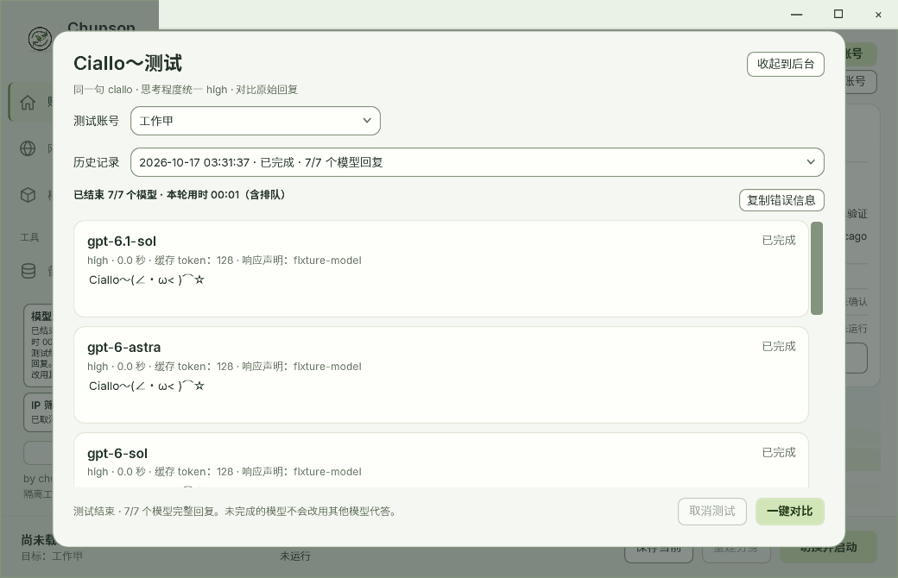
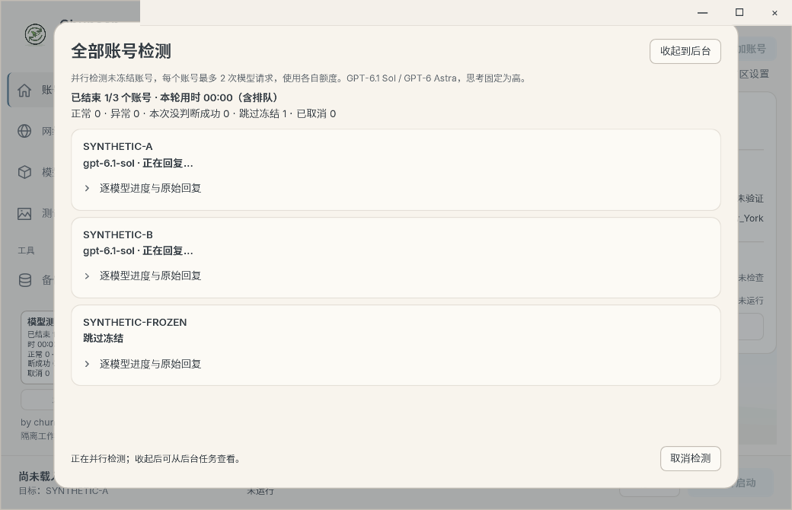
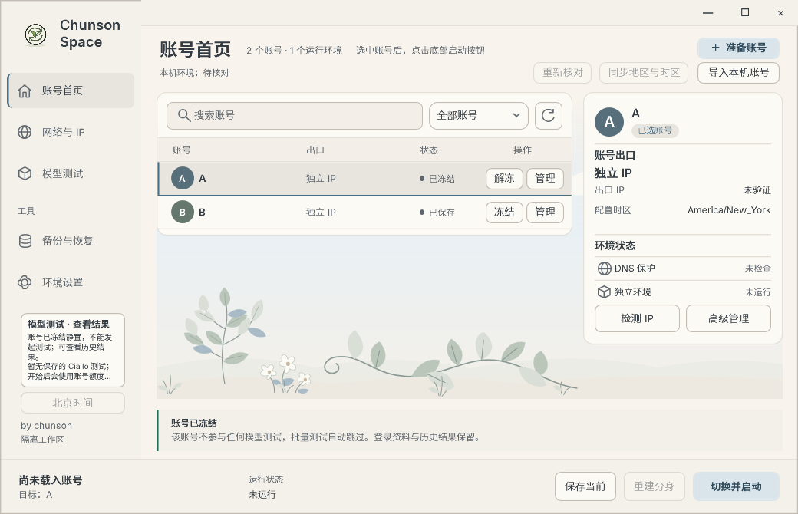
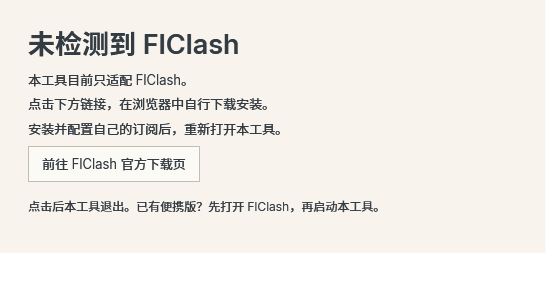
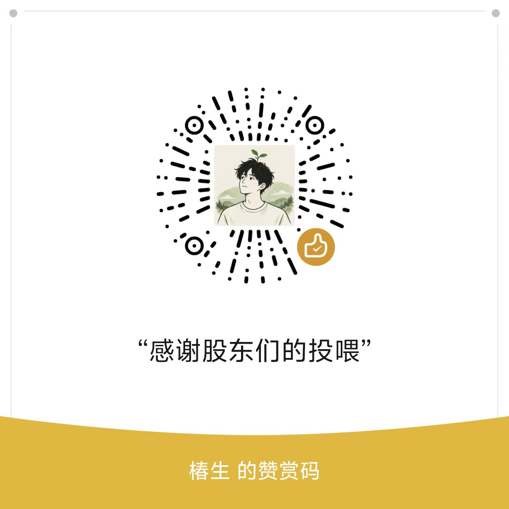

<p align="center">
  
</p>

<p align="center">Windows 10 / 11 · 64 位 · 中文界面 · MIT 开源</p>

<p align="center"><strong>当前版本 1.6.0</strong> · 纸质 / 黑夜主题 · 单账号 / 多账号界面 · 在线更新</p>

<p align="center">
  <a href="https://github.com/chunson-studio/chunson-space/releases/latest/download/Chunson-Full-Windows-x64.zip"></a>
</p>

<p align="center">
  <a href="https://github.com/chunson-studio/chunson-space/releases/latest">全部下载与更新说明</a> ·
  <a href="#一个版本覆盖日常使用">能做什么</a> ·
  <a href="#界面预览">界面预览</a> ·
  <a href="#快速开始">快速开始</a> ·
  <a href="#从源码构建">源码构建</a>
</p>

## 一个版本，覆盖日常使用

**账号管理、英文浏览器、IP 检测、地区与时区同步、模型测试和时钟，都放在一个工具里。** 只需要其中几项功能，直接使用对应入口即可。

**[下载 Windows 完整版 ZIP](https://github.com/chunson-studio/chunson-space/releases/latest/download/Chunson-Full-Windows-x64.zip)**

只维护完整版。原简洁版停止更新，旧源码和下载包保留在历史版本中。

### 在线更新

椿生空间启动时会静默检查本仓库的正式版，有新版本时显示版本与“在线更新 / 查看更新”。设置中也可手动检查。在线更新只下载变化的 ZIP 成员，未变化的运行库不重复下载；校验完成后正常退出管理器、替换程序文件并自动重开，保留账号资料、Codex 本体、分身和时钟。取消或下载失败不替换当前应用；替换失败会回滚并重开原版。

发布必须同时提供 `Chunson-Full-Windows-x64.zip`、`Chunson-Update-Windows-x64.json`、源码 ZIP 和 SHA256SUMS。构建脚本的 `-Package -PythonPath <已有Python>` 从完成的 Full ZIP 生成清单。缺清单的历史版本仅能查看发布页；服务器不支持范围下载时不会退回下载整包。没有更新功能的旧客户端第一次仍需手动升级。

## 1.6.0 更新了什么

- **界面与导航**：纸质 / 黑夜主题，单账号 / 多账号界面；减少切页时重复读取账号与历史记录。
- **账号管理**：显示首次凭证起算的登录小时，可直接更名或删除所选账号；删除不要求先切换账号，也不新建备份。
- **设置与网络**：环境和网络集中在设置页；IPinfo 提供地址与时区，IPPure 提供质量评分，支持 IPv6；FlClash 配置按钮直接执行原配置流程。
- **分身与托盘**：设置中统一为“重置分身”，无账号时也可手动执行，完成后保持关闭；默认关闭窗口进入托盘。Codex 本体保持独立，只管理一个分身。
- **时钟与更新**：正常启动自动复用北京时间小组件，补齐图标及独立安装工具；在线更新按文件下载变化内容，保留独立时钟。
- **稳定性**：修复启动握手和进程归属问题；健康检测题目、提示词、固定规则、默认模型与 high 强度保持不变。

完整记录见 [CHANGELOG](CHANGELOG.md)。

### 保留 1.5.0 的检测功能

- **一键检测所有账号**：未冻结账号最多 16 个并发，各账号内两种模型顺序执行，完成一项就显示一项，支持后台进度与取消。
- **统一健康颜色**：账号正常用绿色文字，账号异常用红色文字；未能判断时保留原标记，不把请求失败当成异常结论。
- **清除全部测试历史**：在测试结果页一次清除所有账号的产品测试记录和作品。保留账号、授权、当前标记、冻结状态、项目、聊天与外部导出；测试运行中不可清除。
- **更简洁的结果**：保留模型原文、历史记录和作品比较，主界面只显示明确结论；修复部分完整回复被误判截断的问题。
- **更新源码名称与界面预览**：公开工程统一使用 ChunsonSpace，复用已经通过的 SYNTHETIC 离线演示截图。

模型测试使用 GPT-6.1 Sol / GPT-6 Astra，思考强度固定为 high；每个账号最多两次模型请求，消耗各自额度。健康标记依据当前规则和完整响应，不能证明实际后端型号或能力。

### 保留 1.4.1 的功能与修复

- **冻结入口更明显**：账号列表每行都有“冻结／解冻”，冻结后保留账号并显示“已冻结”。单独测试与“全部测试”都会跳过它，历史结果仍可查看。
- **FlClash 提示更简单**：未检测到安装时显示通知，点击后用浏览器打开官方下载页，软件随即退出。自行安装、配置订阅后，再打开本工具。
- **修复分身重建失败**：兼容 Codex 自动生成的插件缓存目录链接；只清理受管分身范围，保留账号库和本体。分身不继承本体 Skills、MCP 或插件。
- **报错更具体**：重建失败会显示实际原因与位置，方便复制错误信息反馈。

更新时先结束正在进行的测试和授权，在旧工具中选择“退出工具”，再把新版完整解压到新文件夹运行。账号资料保存在本机独立数据目录。

## 完整版 · 账号与测试工作台

把账号资料、浏览器和测试结果放在一起管理。

- **账号档案**：保存授权与配置；首页“导入本机账号”可读取本机 Codex 已保存的 ChatGPT 授权，无需重新登录。
- **独立网络**：筛选和管理订阅 IP，在“跟随本机”和“独立 IP”之间切换，也可更换已分配的 IP。
- **账号浏览器**：分别保存浏览器资料；独立模式使用对应出口与时区，跟随模式沿用本机环境。
- **模型测试**：固定健康检测与直接输入题目的静态绘图；保留原题目和提示词，不新增题库。
- **结果与缓存**：查看历史回复、作品、耗时和返回的缓存 token 数据。测试可收起到后台，账号之间并行，同一账号内依次执行。
- **实时进度**：等待回复时也显示已用时间、当前步骤和实际回复数量，收起到后台仍会更新。
- **冻结账号**：需要静置时，在账号列表该行点击“冻结”。账号仍在列表里并标记“已冻结”，单账号测试无法启动，批量测试自动跳过；点击“解冻”后才能继续测试，历史结果仍可查看。
- **受管分身**：管理一个 Codex 分身，在其中切换账号；本机 Codex 保持独立，分身不继承本体 Skills、MCP 或工具配置。

导入本机账号只复制已有授权，不修改本体的授权或运行状态，也不会自动开始测试。重复导入同一账号时更新授权，保留已有网络配置。

只有 Edge 也可以使用，无需专门安装 Chrome。这里使用的是本机浏览器的独立资料目录。

## 界面预览

以下保留已审阅的历史版本离线演示截图，账号、IP、回复和缓存数值均为示例；1.6.0 的主题与入口布局已调整，图片不代表当前页面布局或真实账号结果。点击图片可查看大图。

### 完整版首页

集中管理账号，查看出口、环境和分身状态。

[](docs/assets/screenshot-full-home.png)

### 网络与 IP

查看 FlClash 网络配置，从“可用 IP”进入筛选和线路管理。

[](docs/assets/screenshot-network.png)

### 一键账号检测与模型测试

一键检测所有未冻结账号；单账号入口可以选择 Ciallo、绘图等测试。下图账号均为 SYNTHETIC 示例。

[](docs/assets/screenshot-model-tests.png)

### 测试进度与账号冻结

不同账号最多 16 个并发，账号内模型顺序执行；逐账号显示进度，支持收起与取消。下图为已验收的合成并发示例，用时包含排队。

[](docs/assets/screenshot-test-progress.png)

需要静置的账号可以在列表里直接点击“冻结”；批量测试自动跳过，单独测试也会拦截。解冻后不会自动开始测试。

[](docs/assets/screenshot-account-freeze.png)

## 遇到错误怎么反馈

完整版的图形测试、Ciallo 测试和主界面错误提示都有 **复制错误信息**。选择失败的历史记录也能复制，无需重测。

诊断包含版本、时间、测试项目、模型和错误说明；常见令牌、邮箱、路径和 IP 会隐去，不读取授权文件或浏览器资料。复制后检查内容，再粘贴到 [GitHub Issues](https://github.com/chunson-studio/chunson-space/issues) 或发给维护者。工具不会自动上传。

## 内置北京时间小组件

任务栏上的时间卡片，固定显示 **北京时间 UTC+8**。

- 随软件启动；重复打开只保留一个小组件。
- 默认关闭窗口进入托盘，时钟继续显示；显式退出工具会结束受管组件。在线更新交接保留时钟。
- 优先复用已安装的独立小组件；源码包含单用户 MSI 构建与安装工具。
- **只显示时间，不改变 Windows 系统时区。**

## 快速开始

### 1. 下载并完整解压

下载上方压缩包，完整解压后打开 `Full/ChunsonSwitch.exe`。

不要直接在压缩包里运行，也不要只取出一个 EXE。发布包已包含 .NET 运行时，普通使用无需安装开发工具。

### 2. 准备浏览器与网络

- 系统：**Windows 10 / 11 x64**。
- 浏览器：本机已安装 **Chrome 或 Edge**。
- 网络：**必须使用 FlClash，目前只适配这个客户端。** 启动时会检查；没有安装时显示下载通知，点击后在浏览器打开官方发布页，本工具随即退出。请自行下载安装、添加订阅，再重新打开工具。已有便携版请先运行 FlClash。
- 检测到 FlClash 已安装就直接进入主界面，不要求先运行或配置好端口。使用联网功能前，再打开 FlClash、添加自己的订阅并选择节点。支持只开 TUN；工具和独立浏览器连接时仍需可用的主 HTTP / mixed 入口。

下载入口：[FlClash 官方发布页](https://github.com/chen08209/FlClash/releases/latest)。本工具不下载或运行安装包，不附送订阅，也不会替你修改节点或系统代理设置。

[](docs/assets/screenshot-flclash-missing.png)

### 3. 检查后按需同步

先查看出口和环境状态。需要修改时，主动点击“同步地区与时区”；之后再打开浏览器，或在完整版中导入、添加账号。

同步保留 Windows 显示语言、地区格式和输入法；退出软件不会恢复旧时区。FlClash 的分流规则仍会影响各网站的实际出口。

## 可选：重新登录后做对比测试

如果准备重新整理自己的登录状态，可以按下面的顺序操作：

1. 在 FlClash 中选好稳定的出口；完整版可参考 IP 筛选评分。
2. 对使用邮箱与密码登录的账号，在官方登录页面点击 **“忘记密码”**，通过邮件重置密码，再用新密码登录。使用 Google、Apple 或 Microsoft 等方式登录的账号，按原登录方式及其账户恢复流程处理。
3. 检查双重验证（2FA）。没有设置的可以启用；已有设置需要更新时，先确认能够完成验证并保管好恢复方式。
4. 在账号安全设置中选择 **退出所有设备**，待退出生效后，**手动关闭第一步临时浏览器的所有窗口**。项目确认本次后台进程退出，并删除临时资料；清理失败时不会进入第二步。
5. 等项目显示“第一步已清理”，点击 **重新登录并授权**，创建新的 Codex 授权。仅登录 ChatGPT 网页还不代表项目已保存授权；以项目提示保存成功为准。此时应重新授权，不导入重置前留下的旧凭证。
6. 如采用作者的观察方法，登录后静置 **24 小时**，期间不使用该账号；可先“冻结账号”防止误触模型测试，第二天手动解冻，再比较回复、作品、耗时与缓存数据。冻结仅约束本工具的模型测试，不会替你退出其他设备。

这是一套可选的账号整理与对比方法，不是使用软件的前置条件。高 IP 评分、重置密码、更换 2FA 或静置 24 小时，均不能保证解除登录限制或提升模型能力；24 小时是作者建议的观察间隔，不是官方恢复规则。项目不会自动更改密码、2FA 或退出你的设备。

## 常见问题

<details>
<summary><strong>数据保存在哪里？</strong></summary>

账号授权、浏览器资料、订阅和个人配置保存在本机用户目录，不包含在本仓库和公开发布包中。时钟位置保存在 `%LOCALAPPDATA%/ChunsonWidgets`。请不要将自己的运行资料提交到公开仓库。

</details>

<details>
<summary><strong>缓存 token 能代表“智力”吗？</strong></summary>

不能。测试用于观察回复、绘图和修改能力的差异，不提供整体智力结论。缓存 token 是服务返回的使用数据，不作为能力分数；缺少数据与数值为 0 会分开显示。

</details>

<details>
<summary><strong>同步环境后，网站一定能登录成功吗？</strong></summary>

环境同步、网络连通和网站登录是不同的环节。本工具不保证网站登录成功，也不据此判断账号是否受到风控。

</details>

## 从源码构建

需要 **Windows x64、.NET 10 SDK、Windows PowerShell**；生成更新清单还需要 Python 3。在仓库根目录执行：

```powershell
./build.ps1 -Package -PythonPath python -Output ./out/release
```

构建入口只生成完整版；`-DotnetPath` 可指定 SDK，`-DependencyExecutable` 可复用与固定 SHA-256 一致的 Mihomo。`-Verify` 可选，运行完整离线 UI 验证；不传时只构建、列清单和打包。

```text
chunson-space/
├─ ChunsonSpace/             完整版：账号、网络、测试与分身
├─ taskbar-clock/    内置北京时间小组件
├─ FlClashSetup/     FlClash 检查与安装引导
└─ build.ps1         构建、离线验证与打包入口
```

首次构建从 NuGet 还原固定版本依赖；完整版从 Mihomo 官方发布地址下载固定版本并校验 SHA-256。构建不会启动账号登录、修改代理或同步系统设置；离线界面验证窗口不占据桌面、不抢焦点。离线验证不等于真实登录、模型请求或系统设置修改已通过验收。

## 支持作者

如果这个工具对你有帮助，可以通过微信自愿赞赏，支持后续维护。赞赏不影响免费使用与 MIT 授权。

<p align="center">
  
</p>

### 作者自用服务

项目免费开源。下面是椿生自用的第三方服务，也是支持项目维护的收入来源；通过这些推广链接产生的订单可能为作者带来收益，使用本项目无需购买。

- **[纯净 IP · IPEqual](https://www.ipequal.com/?ref=a61b79b103)**：椿生自己在用的 IP 服务。
- **[会员订阅 · 自助服务](https://chunson.aidijia.cc/)**：查看可选订阅及服务说明。

以上服务由第三方提供，不代表 GitHub 或 OpenAI 的推荐或担保。

## 许可

原创部分采用 **[MIT License](LICENSE)**，允许使用、修改、分发及商用，须保留版权声明和许可文本。

第三方组件遵循各自许可证。Mihomo 作为独立外部进程使用，适用 GPL-3.0，详情见 [Mihomo 声明](ChunsonSpace/windows/ThirdParty/Mihomo)。YamlDotNet、GeoTimeZone、ModelTrace 及字体的声明保留在对应 `ThirdParty` 目录；本项目的 MIT 许可不替代它们的许可证。

---

<p align="center">
  <strong>Chunson Space · 椿生</strong><br>
  <a href="https://github.com/chunson-studio/chunson-space/releases/latest">下载软件</a> ·
  <a href="https://github.com/chunson-studio/chunson-space/issues">反馈问题</a>
</p>
