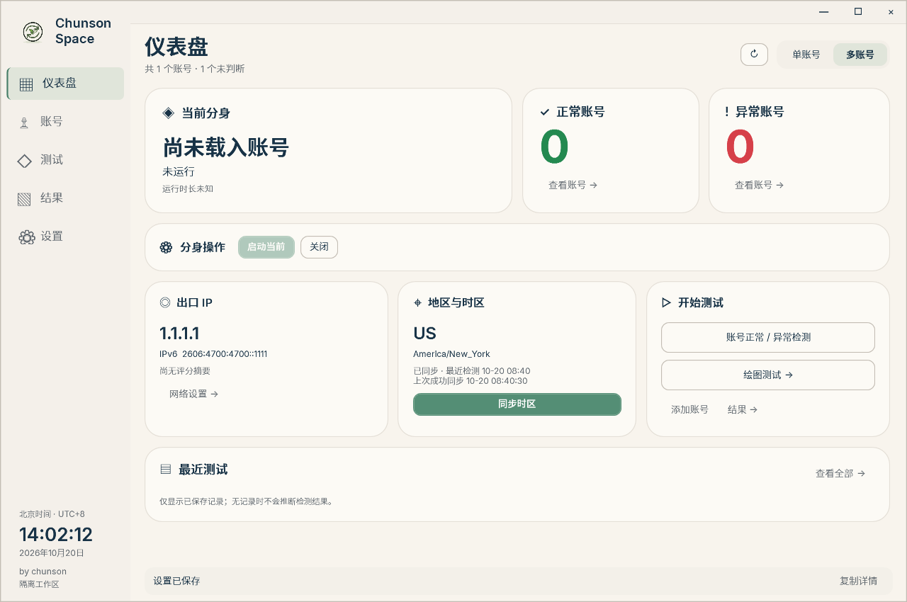
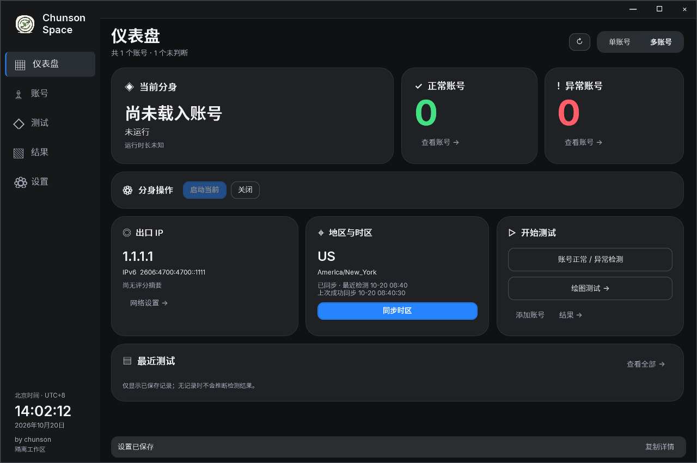
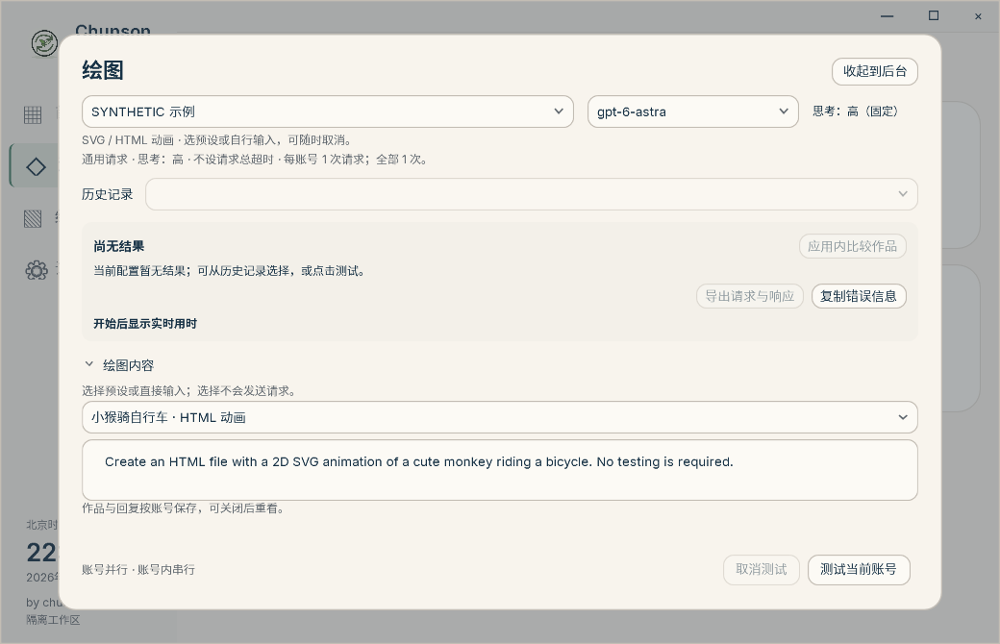
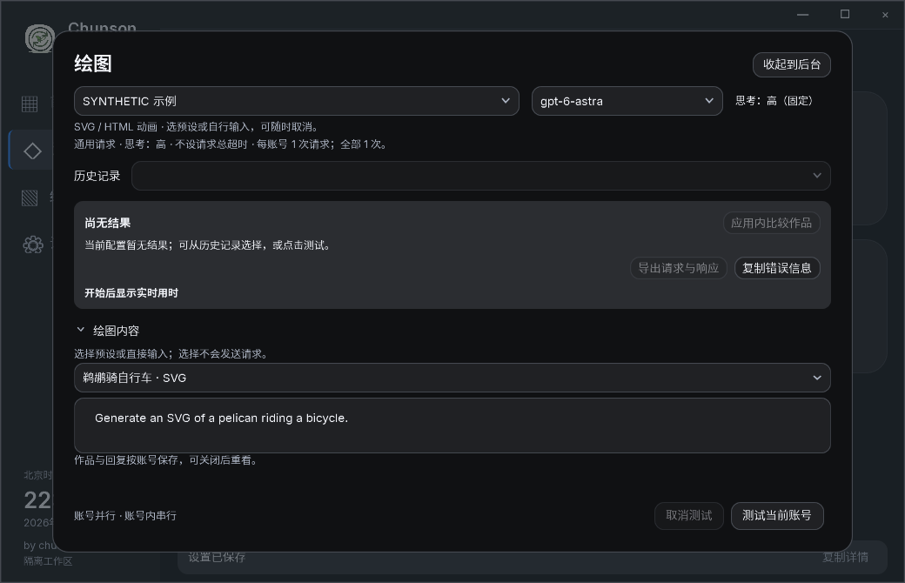

<p align="center"></p>

# Chunson Space · 椿生空间

**在 Windows 上集中管理 Codex 账号、一个独立分身和网络环境。** 2026-10-21 更新的 1.7 安装版提供账号工作台、逐行检测和单模型健康检测。正常启动时自动导入本机已有登录，检查当前出口并尝试同步 Windows 地区与时区。

**[下载 1.7 Windows x64 安装版](https://github.com/chunson-studio/chunson-space/releases/download/v1.7/ChunsonSpace-1.7-Setup-x64.exe)** · [更新说明与附件](https://github.com/chunson-studio/chunson-space/releases/tag/v1.7) · [界面预览（历史）](#界面预览) · [历史公开源码构建](#历史公开源码构建)

适用于 **Windows 10 / 11 x64**，无需安装 SDK。安装器检测兼容的 **x64 .NET 10 Windows Desktop Runtime**：已有则跳过下载，缺失则从 Microsoft 官方下载、校验并引导安装，完成后复检。应用包不捆绑运行库。支持单账号 / 多账号界面及自动 / 纸质 / 黑夜主题，Codex 本体保持独立。

## 三步开始

1. **安装后启动。** 下载并运行 `ChunsonSpace-1.7-Setup-x64.exe`，按提示完成安装，再从桌面或开始菜单启动；安装器不会自动启动管理器。缺少运行库时按提示完成 Microsoft 官方运行库安装。准备本机 Chrome 或 Edge，以及已配置可用订阅、节点和 HTTP / mixed 入口的 [FlClash](https://github.com/chen08209/FlClash/releases/latest)；未检测到安装时会提供官方下载入口。
2. **查看账号工作台和环境状态。** 正常窗口首次显示后尝试一次导入本机 Codex 已有登录，再检查出口并自动同步地区与时区。没有本机登录时可添加 / 登录；需要重试时，单账号首页和多账号工作台都保留手动导入。重复导入按稳定账号身份合并，无变化时不重写授权，保留登录起算时间、名称、环境、冻结和健康记录。
3. **选择账号，主动启动分身。** 核对页面状态后选择要使用的账号，再点击启动分身；添加 / 导入与启动分别操作。工具只管理一个分身，不会因为导入成功就自动切号、启动分身或执行模型测试。

**从旧版升级：请手动下载安装版一次。** 本次仍为 **1.7 / 1.7.0.0**，已经使用旧 1.7 的客户端不会因版本号相同而自动提示这次更新。旧 1.61 的数字比较和 1.6.0 的标签解析也可能阻止提示。请先结束测试与授权，从托盘选择“退出工具”，再运行安装器，完成后手动启动。账号资料保存在独立的本机数据目录。历史 Full ZIP 与本次安装版使用不同更新清单，不要交叉套用。

## 出口、地区与时区会怎样更新

首页、仪表盘和设置共用当前状态，分别展示**最近检测**和**上次成功同步**。启动时先检查出口，再沿原同步流程尝试写入；只有写入成功且新鲜回读确认国家与时区匹配，才保存成功时间。同一出口已经匹配时不重复写入，也不重置成功时间。失败会显示未完成，历史成功不代表现在仍匹配。

- **本地变化触发 + 5 分钟兜底。** FlClash 已知配置 / 选择文件的变动及系统网络事件会触发检查；事件合并约 2 秒，两次事件探测至少间隔 15 秒。另有每 5 分钟主 IP 检查，不能保证切换节点后瞬时发现。主地址优先 IPv4，失败时尝试 IPv6；同 IP 地区缓存最多 30 分钟，手动完整刷新绕过缓存。
- **自动与手动都保留。** 自动同步不会弹出 UAC；权限不足、网络失败或资料缺失时显示未完成，可使用页面上的刷新、同步时区和地区 / 时区设置入口手动重试。显示语言、地区格式和输入法不随之改变，退出后不恢复旧时区。
- **地址查询与质量评分分开。** IPinfo 用于出口地址、地区与时区；IPPure 用于手动质量评分。自动监听不循环评分、切节点、切账号或发送模型请求。关闭到托盘后仍继续监听，实际退出或交接在线更新时释放监听。

## 日常功能

| 功能 | 当前行为 |
| --- | --- |
| 单账号 / 多账号 | 账号工作台分开显示正在运行的身份与准备启动的选择，提供分页、状态计数、登录小时和健康检测时间；单账号模式隐藏批量入口。 |
| 账号管理 | 导入、添加、重命名、冻结 / 解冻、删除；显示从现存首次凭证起算的登录小时。删除无需先切换账号，确认后删除该账号本地资料，不新建备份。 |
| 一个受管分身 | Codex 本体独立保留；切换账号复用一个分身，不继承本体 Skills、MCP 或插件。关闭分身期间仍可导航、选择账号及查看管理详情，维护状态持续显示。 |
| 托盘与关闭 | 默认点击窗口 X 隐藏到托盘；需要结束工具时明确退出，可在设置中调整关闭行为。 |
| 账号浏览器 | 账号各自保存浏览器资料，可跟随本机网络或使用已配置的独立线路。 |
| 历史与作品 | 按全部 / 账号检测 / 绘图测试筛选；文本结果为紧凑行，作品显示缩略图并可比较。保留原始题目、回复、耗时及脱敏错误，缓存 token 缺失与 0 分开显示。 |
| 设置与主题 | 环境、外观和网络集中展示，诊断信息可展开。自动主题按北京时间 07:00（含）至 19:00（不含）显示纸质，其余时间显示黑夜，也可手动选择。 |

## 账号检测与绘图

### 账号健康检测

在账号工作台逐行检测，或批量检测未冻结账号。保留固定 Ciallo 题目与既有健康规则，健康检测统一使用 **GPT-6.1 Sol（`gpt-6.1-sol`）/ high**，每个符合条件的账号只请求一次，不自动追加 Astra、回退模型或重试。不同账号最多 16 个并发，支持后台进度和取消；排队 / 准备、发送、读取和完成分别显示。请求会消耗所选账号额度。

正常 / 异常用绿色 / 红色文字；未判断成功时保留原标记和原文。冻结阻止单独和批量测试，解冻不会自动发请求；历史双模型结果仍按原文保留。健康标记及模型返回信息不证明实际后端型号或整体能力。

### 绘图：两个简单预设，也可自行输入

从首页或账号详情打开绘图面板。通用 / 绘图模型选择仍保留 GPT-6 Astra。选择预设只填入可编辑题目，点击“测试当前账号”才发送。页面导航保留自定义内容，两道预设原文如下：

- **鹈鹕骑自行车 · SVG**：`Generate an SVG of a pelican riding a bicycle.`
- **小猴骑自行车 · HTML 动画**：`Create an HTML file with a 2D SVG animation of a cute monkey riding a bicycle. No testing is required.`

原题直接进入既有请求流程，支持保存 SVG 或包含 SVG 的 HTML，并在本机隔离预览中显示动画。作品查看依赖本机 Chromium 浏览器组件；组件不可用时明确退回保存的图片。没有随机题库或动态评分。

测试结果页可**清除全部测试历史**，包括产品测试记录和作品；保留账号、授权、标记、冻结状态、项目、聊天和外部导出。测试运行时不可清除。

## 界面预览

以下保留的是**历史界面的离线合成截图**，并非本次安装版的当前布局。账号、地址、时间、回复和数值均为 **SYNTHETIC 合成示例**，不表示真实账号或节点测试结果。地区卡片来自较早的 1.7 环境验证（1280 × 850），绘图图来自 1.61；当前账号工作台、结果和设置布局已调整。本次未生成新截图。点击查看原图。

### 历史截图：环境与上次成功同步

| 历史合成示例 · 纸质 | 历史合成示例 · 黑夜 |
| --- | --- |
| [](docs/assets/screenshot-region-paper.png) | [](docs/assets/screenshot-region-night.png) |

当前单账号首页和多账号工作台均保留手动导入与共享环境状态，具体布局与历史截图不同。

### 历史截图：绘图预设与可编辑题目

| 历史合成示例 · HTML 动画 · 纸质 | 历史合成示例 · SVG · 黑夜 |
| --- | --- |
| [](docs/assets/screenshot-drawing-paper.png) | [](docs/assets/screenshot-drawing-night.png) |

## 在线更新与北京时间

**在线更新**从本仓库正式 Release 检查版本，设置中也可手动检查。安装版使用 [App ZIP](https://github.com/chunson-studio/chunson-space/releases/download/v1.7/Chunson-App-Windows-x64.zip) 与 [App 更新清单](https://github.com/chunson-studio/chunson-space/releases/download/v1.7/Chunson-App-Update-Windows-x64.json)（FDD / schema 2）；旧自包含 Full 版继续使用历史 schema 1，二者不能混用。匹配更新清单后只下载 ZIP 中变化的文件；校验后正常退出、替换并重开，保留额外文件和独立时钟。取消或下载失败不替换程序，替换失败沿既有回滚流程处理。缺少匹配清单、不支持范围下载或运行库要求变化时，需手动下载安装版。**本次同版本更新仍需手动安装一次。** 新附件校验值见 [SHA256SUMS-App.txt](https://github.com/chunson-studio/chunson-space/releases/download/v1.7/SHA256SUMS-App.txt)。

**BeijingClock** 独立显示北京时间 UTC+8，不修改系统时区。正常启动优先复用已安装的小组件；关闭到托盘继续显示，在线更新保留独立时钟。

单模型健康检测已通过同一组 **24 项离线合成检查**，开发与最终分发载荷分别验证，不累加数量；本次文档准备未重跑产品测试。该结果不代表真实账号业务、安装器运行或公网在线更新已验收；环境同步、IP 评分和健康标记不保证登录成功或模型能力变化。

## 反馈与数据

遇到错误可使用“复制错误信息”，检查脱敏内容后提交到 [Issues](https://github.com/chunson-studio/chunson-space/issues)。历史失败记录可直接复制，无需重新请求；工具不会自动上传。账号授权、浏览器资料、订阅与个人设置仅在本机用户数据目录，不包含在公开源码或发布包中。时钟位置保存在 `%LOCALAPPDATA%/ChunsonWidgets`。

## 历史公开源码构建

本仓库已有 MIT 源码、原 `v1.7` 标签及源码 ZIP 保留为历史快照，**不对应 2026-10-21 安装版的当前二进制源码**。本次仅更新 README 与 Release 附件 / 说明，当前应用源码未随安装版公开，原标签不移动。

以下命令仅用于构建已有的历史公开源码。需要 Windows x64、.NET 10 SDK、Windows PowerShell；生成历史更新清单还需要 Python 3。在公开仓库根目录运行：

```powershell
./build.ps1 -Package -PythonPath python -Output ./out/release
```

`-DotnetPath` 指定已有 SDK；`-DependencyExecutable` 可复用 SHA-256 匹配的 Mihomo。首次从公开 NuGet 与 Mihomo 发布地址取得固定依赖并校验。`-Verify` 为可选完整离线验证，普通构建无需传入。构建不会执行真实账号操作或修改系统代理、时区。

```text
ChunsonSpace/   Windows 主程序、检查与维护脚本
taskbar-clock/  北京时间小组件和安装工具
FlClashSetup/   FlClash 安装检查与引导
build.ps1      构建与打包入口
```

原有 **Full ZIP、MIT 源码 ZIP、SHA256SUMS.txt、Chunson-Update-Windows-x64.json** 四个历史附件继续保留，不删除或替换。本次新增安装 EXE、App ZIP、App 更新清单与 `SHA256SUMS-App.txt`，不新增源码包。版本显示与标签仍为 **1.7 / v1.7**，程序集与清单仍为 `1.7.0.0`。历史源码变更见 [CHANGELOG](CHANGELOG.md)，当前安装版说明见 [Release](https://github.com/chunson-studio/chunson-space/releases/tag/v1.7)。

## 支持作者

如果这个工具对你有帮助，可以通过微信自愿赞赏，支持后续维护。赞赏不影响免费使用与 MIT 授权。

<p align="center">
  
</p>

### 作者自用服务

本仓库保留已有开源源码与许可。下面是椿生自用的第三方服务，也是支持项目维护的收入来源；通过这些推广链接产生的订单可能为作者带来收益，使用本项目无需购买。

- **[纯净 IP · IPEqual](https://www.ipequal.com/?ref=a61b79b103)**：椿生自己在用的 IP 服务。
- **[会员订阅 · 自助服务](https://chunson.aidijia.cc/)**：查看可选订阅及服务说明。

以上服务由第三方提供，不代表 GitHub 或 OpenAI 的推荐或担保。

## 许可

本仓库已公开源码的原创部分采用 **[MIT License](LICENSE)**，允许使用、修改、分发及商用，须保留版权声明和许可文本。已有许可与授权保持不变。

第三方组件遵循各自许可证。Mihomo 作为独立外部进程使用，适用 GPL-3.0，详情见 [Mihomo 声明](ChunsonSpace/windows/ThirdParty/Mihomo)。YamlDotNet、GeoTimeZone、ModelTrace 及字体的声明保留在对应 `ThirdParty` 目录；本项目的 MIT 许可不替代它们的许可证。.NET Windows Desktop 的开源地址为 [dotnet/windowsdesktop](https://github.com/dotnet/windowsdesktop)，安装包保留相关第三方声明。

---

<p align="center">
  <strong>Chunson Space · 椿生</strong><br>
  <a href="https://github.com/chunson-studio/chunson-space/releases/latest">下载软件</a> ·
  <a href="https://github.com/chunson-studio/chunson-space/issues">反馈问题</a>
</p>

