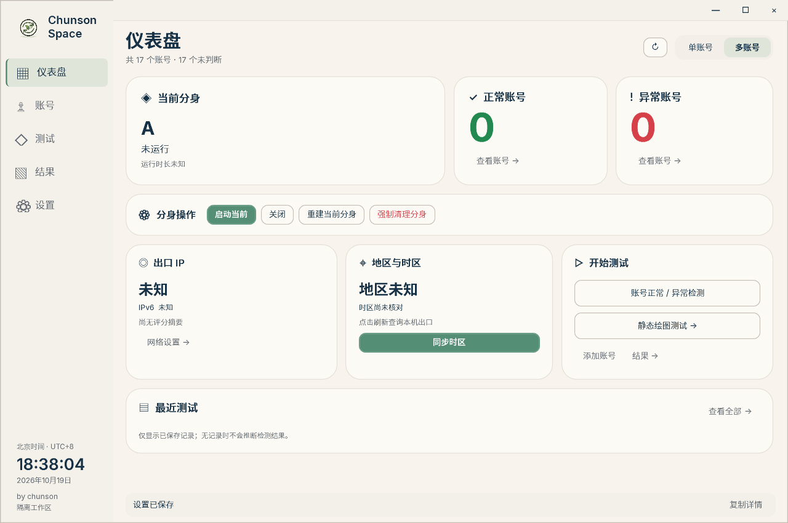
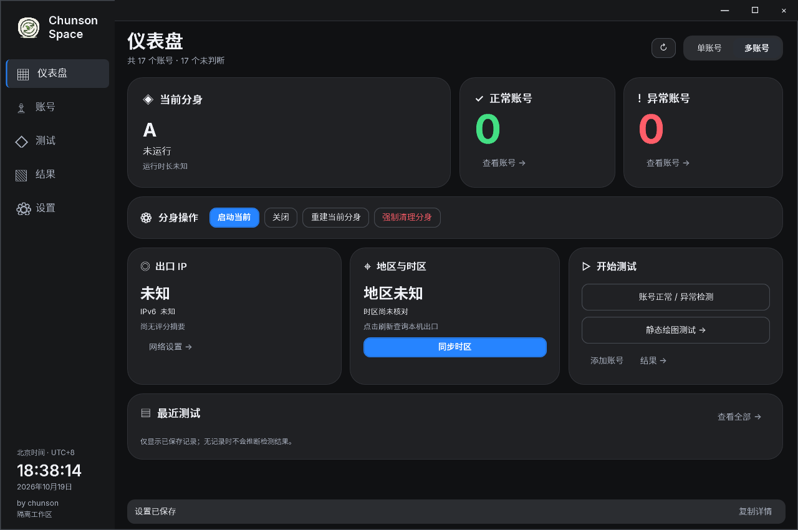
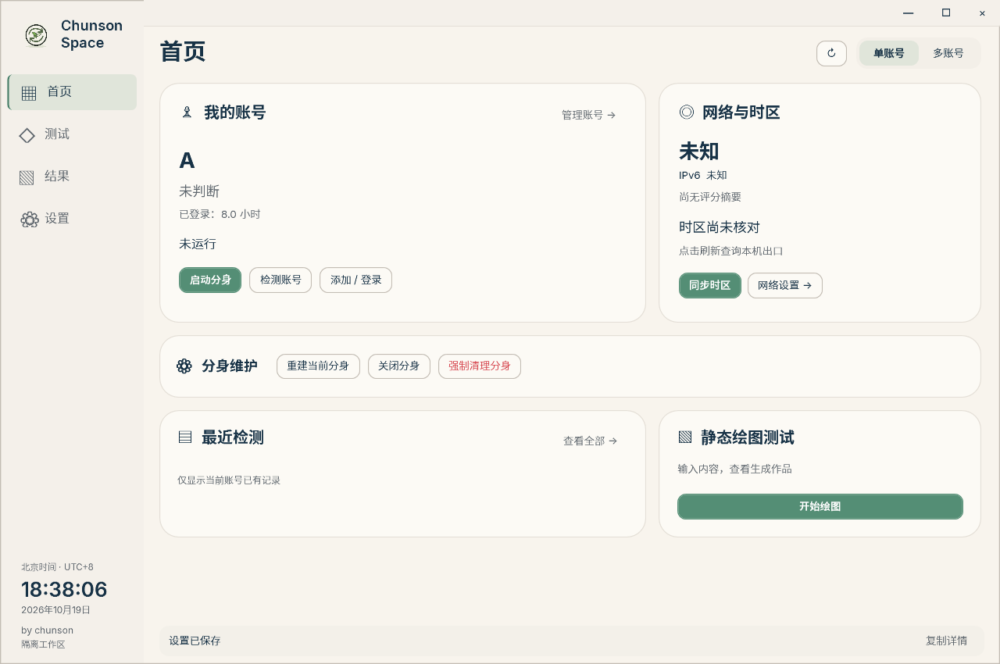
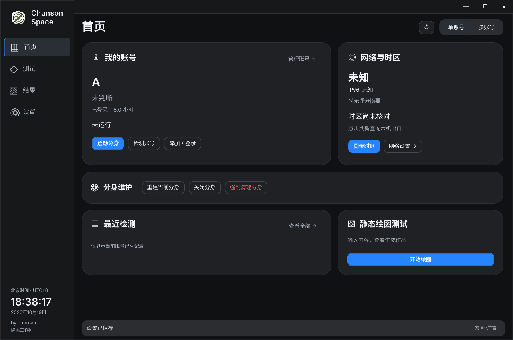

<p align="center"></p>

# Chunson Space · 椿生空间

**在 Windows 上集中管理 Codex 账号、一个独立分身、网络环境和测试历史。** 支持单账号 / 多账号界面、纸质 / 黑夜主题，Codex 本体保持独立。

<p align="center"><a href="https://github.com/chunson-studio/chunson-space/releases/download/v1.61/Chunson-Full-Windows-x64.zip"></a></p>

**[下载 1.61 完整版](https://github.com/chunson-studio/chunson-space/releases/download/v1.61/Chunson-Full-Windows-x64.zip)** · [更新说明与四个附件](https://github.com/chunson-studio/chunson-space/releases/tag/v1.61) · [界面预览](#界面预览) · [源码构建](#源码构建)

只维护完整版；已包含 .NET 运行时，无需安装 SDK。版本为 **1.61**，程序集与更新清单采用兼容的 `1.61.0.0`。

## 三步开始

1. 在 **Windows 10 / 11 x64** 下载并完整解压 ZIP，运行 `Full/ChunsonSwitch.exe`。不要在压缩包中运行，也不要只复制 EXE。
2. 准备本机 Chrome 或 Edge，以及 [FlClash](https://github.com/chen08209/FlClash/releases/latest)。未检测到 FlClash 安装时，工具会提供官方下载入口；检测到安装即可进入界面。联网功能需要你已配置好的订阅、节点及可用 HTTP / mixed 入口。
3. 导入本机已有授权，或添加账号。按需要选择单账号 / 多账号界面，查看环境后再主动同步地区与时区、打开账号浏览器或启动分身。导入和查看历史不会自动开始模型测试。

**从 1.6.0 升到 1.61，请手动下载完整包。** 1.6.0 的版本解析不接受本次两段 `v1.61`；1.61 已兼容两段和三段版本。本次未验证旧客户端自动升级。先结束测试与授权，再从托盘选择“退出工具”，把新包完整解压到新文件夹运行。账号资料保存在独立的本机数据目录。

## 日常功能

| 功能 | 当前行为 |
| --- | --- |
| 单账号 / 多账号 | 按使用习惯切换界面；首页查看账号、出口、环境与分身状态，减少切页重复读盘。 |
| 账号管理 | 导入已有授权、添加、重命名、冻结 / 解冻、删除；显示从现存首次凭证起算的登录小时。删除无需先切换账号，确认后删除该账号本地资料，不新建备份。 |
| 一个受管分身 | Codex 本体独立保留。切换账号复用一个分身；不继承本体 Skills、MCP 或插件。设置中统一“重置分身”，无账号也可操作，重置完成后保持关闭。 |
| 托盘与关闭 | 默认关闭窗口进入托盘；需要结束工具时从托盘或工具内明确退出。可在设置中调整关闭行为。 |
| 网络与环境 | IPinfo 提供地址、地区与时区；IPPure 提供质量评分，来源分别展示，支持 IPv6。地区与时区同步需显式点击，不改变显示语言、地区格式或输入法，退出不恢复旧时区。 |
| 账号浏览器 | 账号各自保存浏览器资料，可跟随本机网络或使用已配置的独立线路。 |
| 历史与作品 | 保留原始题目、回复、作品和耗时；返回的缓存 token 为使用数据，缺失与 0 分开显示。可比较作品、复制脱敏错误信息。 |

## 两个测试入口

### 账号健康检测

保留固定 Ciallo 题目与既有健康规则，默认 GPT-6.1 Sol / GPT-6 Astra、high。可一键检测未冻结账号，不同账号最多 16 个并发，同账号内两模型顺序执行，支持后台进度和取消。请求会消耗所选账号额度。

正常 / 异常用绿色 / 红色文字；未判断成功时保留原标记和原文。冻结阻止单独和批量测试，解冻不会自动发请求。健康标记及模型返回信息不证明实际后端型号或整体能力。

### 绘图：两个简单预设，也可自行输入

选择预设只填入可编辑的题目，点击“测试当前账号”才发送。页面导航不会把自定义内容替换为默认题目。两道预设原文如下：

- **鹈鹕骑自行车 · SVG**：`Generate an SVG of a pelican riding a bicycle.`
- **小猴骑自行车 · HTML 动画**：`Create an HTML file with a 2D SVG animation of a cute monkey riding a bicycle. No testing is required.`

原题直接进入既有请求流程，不附加静态绘图限制；支持保存 SVG 或包含 SVG 的 HTML，并在本机隔离预览中显示动画。作品查看依赖本机 Chromium 浏览器组件；组件不可用时明确退回保存的图片。没有随机题库或动态评分。

测试结果页可**清除全部测试历史**，包括产品测试记录和作品；保留账号、授权、标记、冻结状态、项目、聊天和外部导出。测试运行时不可清除。

## 界面预览

以下均为实际 WPF 界面的离线夹具截图，账号、回复和数值是 **SYNTHETIC 合成示例**，不表示真实账号运行结果。首页与单账号图复用已通过的 v2 布局截图，并非重新拍摄的 1.61 界面：其中部分重建 / 维护按钮后来已合并为设置中的“重置分身”，当前行为以本文说明为准。绘图图来自 1.61 的窄专项验证。点击查看原图。

### 多账号首页 · 纸质与黑夜

| 纸质 | 黑夜 |
| --- | --- |
| [](docs/assets/screenshot-dashboard-paper-1280.png) | [](docs/assets/screenshot-dashboard-night-1280.png) |

[1040 宽纸质首页](docs/assets/screenshot-dashboard-paper-1040.png) · [1040 宽黑夜首页](docs/assets/screenshot-dashboard-night-1040.png)

### 单账号界面 · 更聚焦当前账号

| 纸质 | 黑夜 |
| --- | --- |
| [](docs/assets/screenshot-single-paper-1280.png) | [](docs/assets/screenshot-single-night-1280.png) |

[1040 宽纸质单账号](docs/assets/screenshot-single-paper-1040.png) · [1040 宽黑夜单账号](docs/assets/screenshot-single-night-1040.png)

### 绘图预设与可编辑题目

| HTML 动画题目 · 纸质 | SVG 题目 · 黑夜 |
| --- | --- |
| [](docs/assets/screenshot-drawing-paper.png) | [](docs/assets/screenshot-drawing-night.png) |

## 在线更新与北京时间

**在线更新**从本仓库正式 Release 检查版本，设置中也可手动检查。匹配更新清单后，只下载完整 ZIP 中变化的文件，未改变的运行库不重复下载；校验后正常退出、替换并重开，保留额外文件和独立时钟。取消或下载失败不替换程序，替换失败沿既有回滚流程处理。不支持范围下载或缺少清单时需查看发布页手动下载。

**BeijingClock** 显示北京时间 UTC+8，不修改系统时区。正常启动优先复用已安装的小组件；关闭到托盘继续显示，在线更新保留独立时钟。源码与包中保留单用户安装工具和图标。

实现和离线验证与真实业务验收分开记录：本次未执行真实账号、健康、绘图、节点请求或公网在线安装，不承诺环境同步、IP 评分或检测一定带来登录成功或模型能力变化。

## 反馈与数据

遇到错误可使用“复制错误信息”，检查脱敏内容后提交到 [Issues](https://github.com/chunson-studio/chunson-space/issues)。历史失败记录可直接复制，无需重新请求；工具不会自动上传。账号授权、浏览器资料、订阅与个人设置仅在本机用户数据目录，不包含在公开源码或发布包中。时钟位置保存在 `%LOCALAPPDATA%/ChunsonWidgets`。

## 源码构建

需要 Windows x64、.NET 10 SDK、Windows PowerShell；生成更新清单还需要 Python 3。在公开仓库根目录运行：

```powershell
./build.ps1 -Package -PythonPath python -Output ./out/release
```

`-DotnetPath` 指定已有 SDK；`-DependencyExecutable` 可复用 SHA-256 匹配的 Mihomo。首次从公开 NuGet 与 Mihomo 发布地址取得固定依赖并校验。`-Verify` 为可选完整离线验证，普通构建无需传入。构建不会执行真实账号操作或修改系统代理、时区。

```text
ChunsonSpace/   Windows 主程序、检查与维护脚本
taskbar-clock/  北京时间小组件和安装工具
FlClashSetup/   FlClash 安装检查与引导
build.ps1      构建与打包入口
```

每次正式发布提供 **Full ZIP、MIT 源码 ZIP、SHA256SUMS.txt、Chunson-Update-Windows-x64.json** 四个附件。源码 ZIP 对应发布标签；更新清单描述完整 ZIP 的文件成员。详细变更见 [CHANGELOG](CHANGELOG.md)。

## 支持作者

如果这个工具对你有帮助，可以通过微信自愿赞赏，支持后续维护。赞赏不影响免费使用与 MIT 授权。

<p align="center">
  
</p>

### 作者自用服务

项目免费开源。下面是椿生自用的第三方服务，也是支持项目维护的收入来源；通过这些推广链接产生的订单可能为作者带来收益，使用本项目无需购买。

- **[纯净 IP · IPEqual](https://www.ipequal.com/?ref=a61b79b103)**：椿生自己在用的 IP 服务。
- **[会员订阅 · 自助服务](https://chunson.aidijia.cc/)**：查看可选订阅及服务说明。

以上服务由第三方提供，不代表 GitHub 或 OpenAI 的推荐或担保。

## 许可

原创部分采用 **[MIT License](LICENSE)**，允许使用、修改、分发及商用，须保留版权声明和许可文本。

第三方组件遵循各自许可证。Mihomo 作为独立外部进程使用，适用 GPL-3.0，详情见 [Mihomo 声明](ChunsonSpace/windows/ThirdParty/Mihomo)。YamlDotNet、GeoTimeZone、ModelTrace 及字体的声明保留在对应 `ThirdParty` 目录；本项目的 MIT 许可不替代它们的许可证。

---

<p align="center">
  <strong>Chunson Space · 椿生</strong><br>
  <a href="https://github.com/chunson-studio/chunson-space/releases/latest">下载软件</a> ·
  <a href="https://github.com/chunson-studio/chunson-space/issues">反馈问题</a>
</p>
